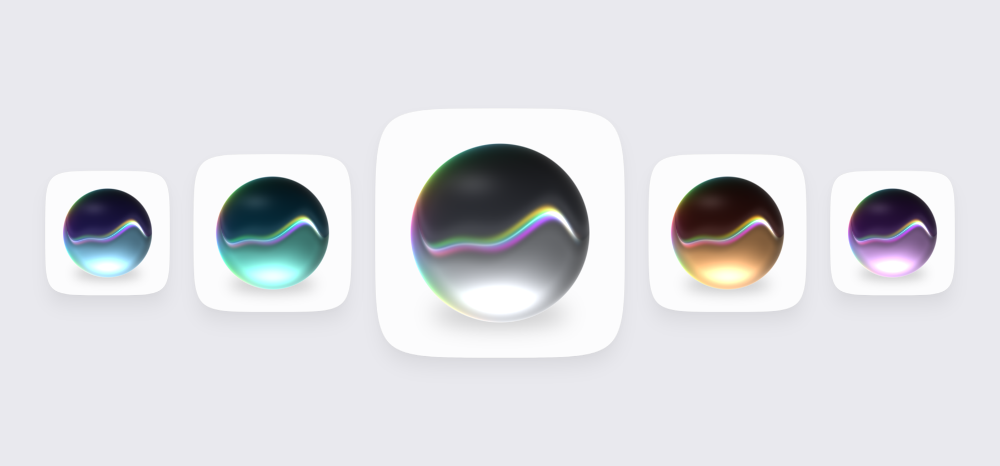
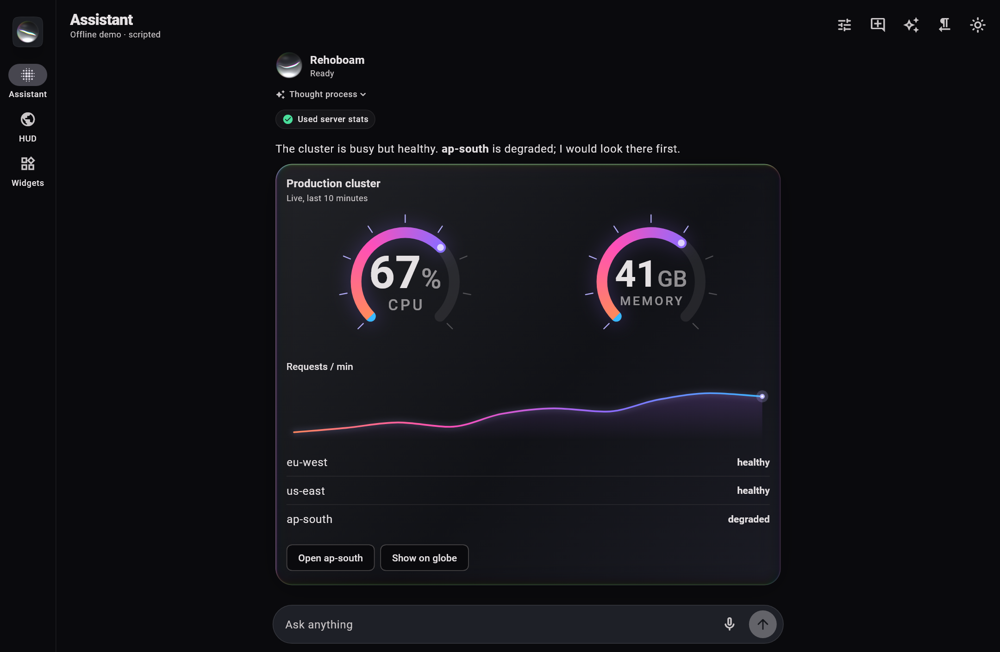
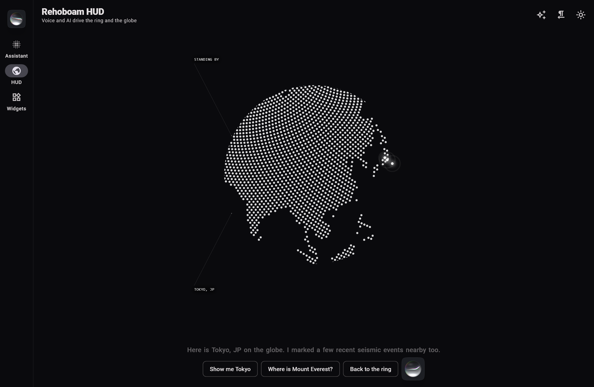
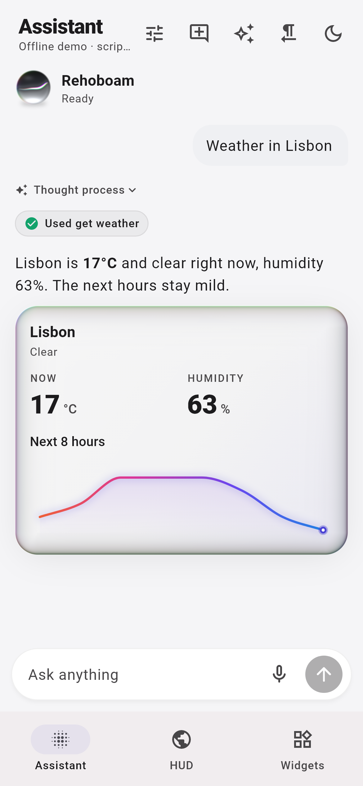
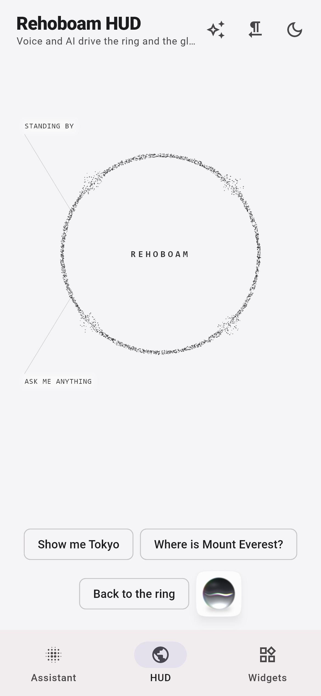
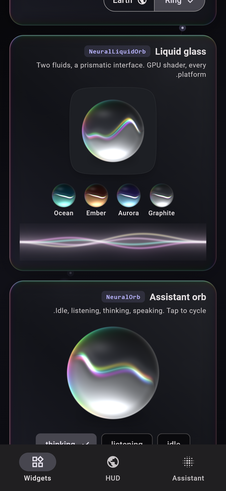
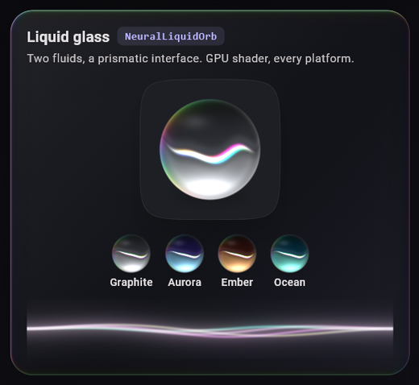
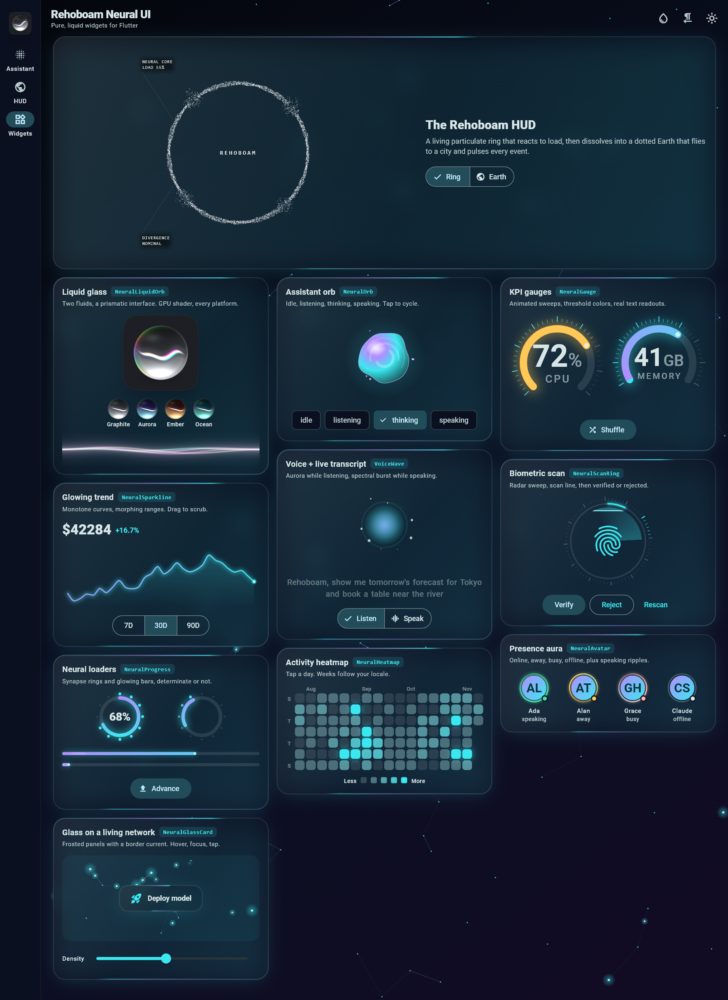

# rehoboam_neural_ui

[](https://pub.dev/packages/rehoboam_neural_ui)
[](#platforms)
[](LICENSE)

**AI-native UI for Flutter.** A pure, liquid-glass design system, the organic
*Rehoboam* HUD with its 3D globe, and an AI layer that connects to **Claude,
Gemini, OpenAI-compatible APIs, Genkit flows or any model**, with tools,
generative UI, voice and a complete chat view.




| Assistant: tools and generated UI | Rehoboam HUD flown by the model |
| :---: | :---: |
|  |  |

| Phone, light | HUD, light | Right-to-left |
| :---: | :---: | :---: |
|  |  |  |

## Why

- **One API for every model.** Swap Claude for Gemini, a local Ollama model or
  your own Genkit backend by changing one line. Streaming, tool calls,
  reasoning summaries and refusals look the same everywhere.
- **Agents that do things.** Tools with JSON Schema validation, approval
  gates, multi-step loops, retries and cancellation.
- **Generative UI.** The model answers with live cards, gauges, charts,
  lists and buttons from a component catalog instead of walls of text.
- **Voice.** Speech-to-text and text-to-speech drive the orb, the HUD and
  read-along transcripts. Works with any plugin, or with the browser's
  built-in speech on the web (no plugin at all).
- **A design language, not a widget pile.** Liquid glass, prismatic light
  and calm motion by default (or the original neon), themed from your
  `ColorScheme`, RTL-aware, accessible, reduced-motion safe.

## Quick start

```yaml
dependencies:
  rehoboam_neural_ui: ^1.1.0
```

A complete assistant screen in a few lines:

```dart
import 'package:rehoboam_neural_ui/rehoboam_neural_ui.dart';

final agent = NeuralAgent(
  model: ClaudeModel(baseUrl: 'https://your-proxy.example.com'),
  system: 'You are a concise assistant.',
  tools: [weatherTool],
  uiCatalog: NeuralUiCatalog.standard(), // lets the model draw UI
);

Scaffold(body: NeuralChatView(agent: agent, title: 'Assistant'));
```

A tool is a name, a JSON Schema and a function:

```dart
final weatherTool = NeuralTool(
  name: 'get_weather',
  description: 'Current weather for a city.',
  parameters: {
    'type': 'object',
    'properties': {'city': {'type': 'string'}},
    'required': ['city'],
  },
  handler: (args, ctx) async => {'city': args['city'], 'tempC': 21},
);
```

## Models

| Adapter | Connects to |
| --- | --- |
| `ClaudeModel` | Anthropic Messages API. Defaults: `claude-opus-5-5`, adaptive thinking with summarized reasoning, streaming, eager tool-input streaming, server-side refusal fallbacks. Thinking blocks are replayed unchanged for multi-step tool use. |
| `GeminiModel` | Gemini API (`streamGenerateContent`, default `gemini-3.8-flash`). Thought signatures are replayed exactly as required for function calling. |
| `OpenAICompatibleModel` | Any Chat Completions server: `.openAI`, `.openRouter`, `.groq`, `.ollama`, `.lmStudio`, or a custom `baseUrl` (Together, DeepSeek, Mistral, vLLM, llama.cpp...). |
| `GenkitFlowModel` | A Genkit flow over HTTP (`startFlowServer` / `expressHandler` / Go handler), streamed. |
| `CallbackModel` | Anything else: Firebase AI Logic, on-device models, a WebSocket. Wrap a `Stream<String>` or full events in one function. |
| `ScriptedModel` | Offline playback for demos, tests and screenshots. |

```dart
agent.model = GeminiModel(apiKey: key);                          // switch any time
agent.model = OpenAICompatibleModel.ollama(model: 'qwen3');       // local
agent.model = GenkitFlowModel(url: Uri.parse('https://api.example.com/chat'));
agent.model = CallbackModel.text((r) => mySdk.stream(r.messages.last.text));
```

> **Keys:** don't ship provider keys inside an app. Point `baseUrl` at your
> own proxy, a Genkit flow, or Firebase AI Logic (via `CallbackModel`), and
> pass your auth in `headers`. Direct keys are fine for prototypes and
> local models.

## Agent

`NeuralAgent` is a `ChangeNotifier`. Per-token and per-frame data are separate
`ValueListenable`s, so UIs rebuild only what changes.

| Member | What it gives you |
| --- | --- |
| `send(text, images:)`, `retry()`, `stop()`, `clear()` | Run, regenerate, cancel, reset. |
| `phase` | `idle`, `listening`, `thinking`, `responding`, `usingTool`, `speaking`, `error`. |
| `orbState`, `level` | Feed `NeuralOrb` / `NeuralLiquidOrb` / the HUD directly. |
| `streamingText`, `reasoningText` | The live answer and reasoning summary. |
| `messages` | The conversation (JSON-serializable with `toJson` / `fromJson`). |
| `onApproveTool` | Asked before any tool with `requiresApproval: true`. |
| `maxSteps`, `maxRetries` | Tool-loop cap; retries for 429 / 5xx / network before output. |
| `listen()`, `speak()`, `speakReplies` | Voice in and out. |

Arguments are validated against each tool's schema before the tool runs;
invalid JSON, unknown tools, declined approvals and thrown errors go back to
the model as error results, never as crashes. Refused or truncated turns
never execute tools.

## Generative UI

Give the agent a `NeuralUiCatalog` and the model gets a `render_ui` tool. Its
specs are plain JSON:

```json
{"type": "card", "props": {"title": "Production"}, "children": [
  {"type": "row", "children": [
    {"type": "gauge", "props": {"label": "CPU", "value": 67, "unit": "%"}},
    {"type": "stat", "props": {"label": "Requests", "value": "1.2k", "delta": "+8%"}}
  ]},
  {"type": "buttons", "props": {"options": [{"label": "Details", "action": "Show details"}]}}
]}
```

Built in: `column`, `row`, `card`, `text`, `stat`, `gauge`, `sparkline`,
`progress`, `list`, `buttons`. Add your own with `NeuralUiComponent` (a name, a
props schema, a builder). Specs are validated, unknown types render a notice,
and button taps come back to the model as user messages. `catalog.jsonSchemas`
exposes every component schema for A2UI, Genkit or any other function-calling
framework. `NeuralUiSurface` renders a spec anywhere, not only in the chat.

## Voice

```dart
agent
  ..speechToText = WebSpeechToText()   // browser speech, no plugin (web)
  ..textToSpeech = WebTextToSpeech()
  ..speakReplies = true;
await agent.listen();                  // hear -> send -> answer -> speak
```

On mobile and desktop, adapt any plugin in a few lines with
`CallbackSpeechToText` / `CallbackTextToSpeech` (examples for
`speech_to_text` and `flutter_tts` are in their API docs). `SimulatedSpeech`
gives deterministic voice for demos and tests.

## The Rehoboam HUD, now AI-driven

```dart
final hud = RehoboamController()..bindAgent(agent);
hud.tools.forEach(agent.addTool);           // the model can fly the globe
RehoboamHud(controller: hud, size: 420);
```

The ring breathes with the microphone, spikes while the assistant speaks and
captions the agent's phase. Ask "show me Tokyo" and the model calls
`show_on_globe`: the ring dissolves into the dotted Earth, flies there and
pulses event markers. `AiThinkingAnimation` is still available directly.

## Widgets

| | | |
| :---: | :---: | :---: |
|  <br> **`NeuralLiquidOrb`** · **`NeuralWaveform`**<br>liquid glass orb, voice ribbons |  <br> **`NeuralOrb`**<br>assistant states |  <br> **`NeuralGauge`**<br>KPI ring with thresholds |
|  <br> **`NeuralSparkline`**<br>scrubbable trend |  <br> **`VoiceWave`** · **`WordByWordTranscript`** |  <br> **`NeuralScanRing`**<br>scan, verify, reject |
|  <br> **`NeuralProgress`**<br>ring and bar loaders |  <br> **`NeuralHeatmap`**<br>activity calendar |  <br> **`NeuralAvatar`**<br>presence aura |
|  <br> **`NeuralGlassCard`** · **`NeuralNetworkBackground`** |  <br> **`AiThinkingAnimation`**<br>ring and Earth | **`NeuralEdgeGlow`**<br>assistant glow around a screen, card or input<br><br>**`NeuralChatView`**<br>the whole conversation UI |

Every widget in both designs:

| Liquid, light | Neon, dark |
| :---: | :---: |
|  |  |

### Key parameters

| Widget | Highlights |
| --- | --- |
| `NeuralLiquidOrb` | `state`, `level`, `palette` (`graphite`, `aurora`, `ember`, `ocean`, `orchid`, `fromScheme`), `tile`, `onTap` |
| `NeuralOrb` | Same states; liquid orb in the liquid design, organic blob in neon |
| `NeuralWaveform` | `level`, `active`, `colors` |
| `NeuralEdgeGlow` | `active`, `level`, `borderRadius`, `width` |
| `NeuralChatView` | `agent`, `title`, `suggestions`, `strings` (localizable), `emptyState` |
| `NeuralGauge` | `value`, `min`, `max`, `unit`, `label`, `thresholds`, `sweepDegrees` |
| `NeuralSparkline` | `data` (NaN = gap), `onScrub`, `valueFormatter`, `mirrorInRtl` |
| `NeuralProgress` / `.linear` | `value` (null = indeterminate), `child` |
| `NeuralHeatmap` | `values` (DST-safe day buckets), `weeks`, `onCellTap` |
| `NeuralScanRing` | `status`, `progress`, `onResolved`, `statusLabels` |
| `NeuralAvatar` | `image`, `name`, `presence`, `speaking`, `level` |
| `NeuralGlassCard` | `child`, `onTap` (keyboard accessible), `blur` |
| `NeuralNetworkBackground` | `density`, `linkDistance`, `interactive`, `seed` |
| `AiThinkingAnimation` | `level`, `mode`, `hudMode`, `targetLat` / `targetLon`, `geoPoints`, labels |

## Theming

Colors resolve from a widget argument, then the `NeuralThemeData` extension,
then your `ColorScheme`:

```dart
ThemeData(
  colorScheme: ColorScheme.fromSeed(seedColor: Colors.indigo),
  extensions: const [
    NeuralThemeData(
      design: NeuralDesign.liquid,      // or NeuralDesign.neon
      spectrum: [Color(0xFFFF8A5B), Color(0xFFFF4FB8), Color(0xFF8D6BFF), Color(0xFF39B8FF)],
      glowIntensity: 0.5,
    ),
  ],
)
```

## Shaders

The liquid orb, waveform, edge glow and glass rim are GPU fragment shaders
bundled with the package (no setup). Each widget paints a gradient fallback
until its shader is ready, so nothing ever blocks. Optionally warm them up:

```dart
WidgetsFlutterBinding.ensureInitialized();
await NeuralShaders.precache();
```

## Accessibility, motion, RTL

- Meaningful semantics everywhere: the chat streams into a live region, tool
  chips and scan states are announced, gauges and charts expose values.
- `MediaQuery.disableAnimations` gives still frames and instant state changes.
- HUD labels, progress, gauges, charts, heatmap weeks, bubbles and badges all
  mirror in right-to-left locales; chat strings are localizable.

## Platforms

Android, iOS, web, macOS, Windows and Linux. Pure Dart and Flutter: no
`dart:io`, no native code. Network calls use `package:http` (streaming works
on the web through the Fetch API); browser speech uses `dart:js_interop` and
is compiled only for the web.

## Example

The [example](example/lib/main.dart) is a full app with **Assistant**, **HUD**
and **Widgets** sections, light and dark, liquid and neon, LTR and RTL. It runs
offline with a scripted model; open *Model settings* to plug in Claude,
Gemini, an OpenAI-compatible API or a local Ollama model.

Screenshots are rendered from widget tests with real fonts:

```sh
cd example
flutter test test/screenshots_test.dart --dart-define=CAPTURE=true
python tool/make_media.py
```

## License

MIT
