# rehoboam_neural_ui

[](https://pub.dev/packages/rehoboam_neural_ui)
[](#platforms)
[](LICENSE)

Sci-fi **neural UI** for Flutter. The organic *Rehoboam* HUD ring and 3D globe,
plus nine widgets for real apps: an assistant orb, voice visuals, KPI gauges,
glowing charts, an activity heatmap, glass cards, a biometric scan ring,
presence avatars and a living network background.

Pure Flutter (no shaders, no platform code), themed from your `ColorScheme`
in light and dark, right-to-left aware, accessible, and respectful of
*reduce motion*.

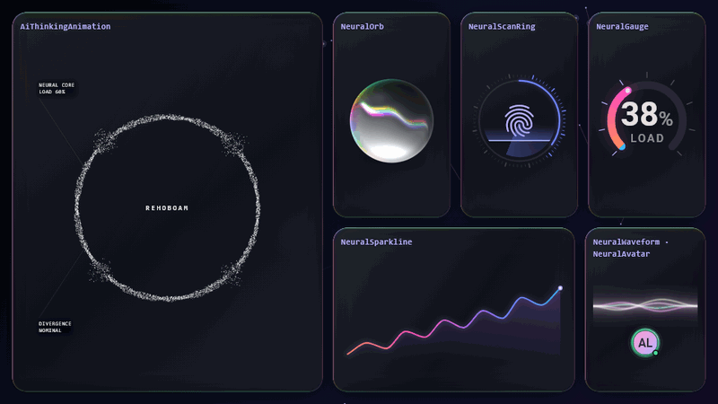

## Gallery

| | | |
| :---: | :---: | :---: |
| 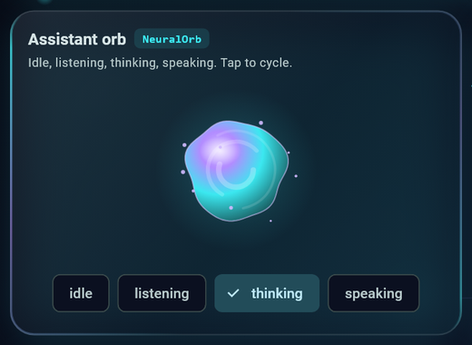 <br> **`NeuralOrb`**<br>assistant orb: idle, listening, thinking, speaking | 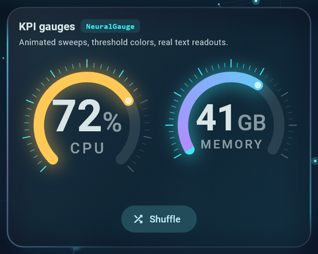 <br> **`NeuralGauge`**<br>animated KPI ring with thresholds | 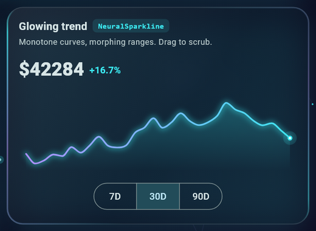 <br> **`NeuralSparkline`**<br>glowing, scrubbable trend line |
| 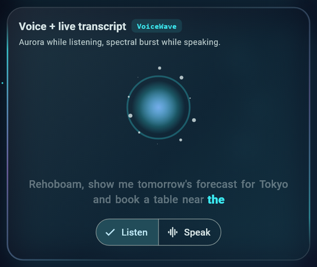 <br> **`VoiceWave`** + **`WordByWordTranscript`**<br>voice visual and live captions | 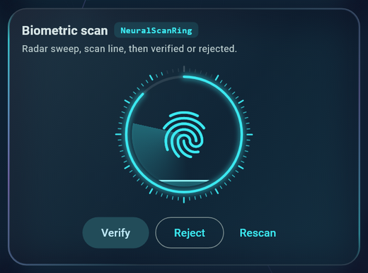 <br> **`NeuralScanRing`**<br>scan / verify with success and failure | 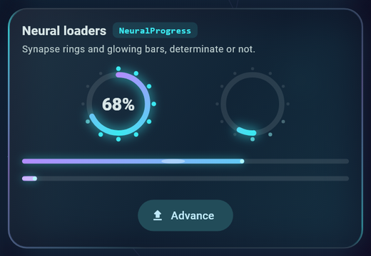 <br> **`NeuralProgress`**<br>synapse ring and glowing bar loaders |
| 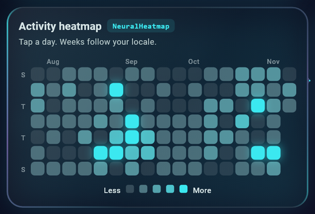 <br> **`NeuralHeatmap`**<br>activity calendar with glow | 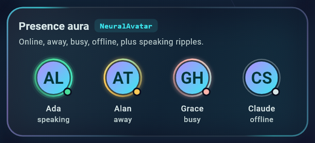 <br> **`NeuralAvatar`**<br>presence aura and speaking ripples | 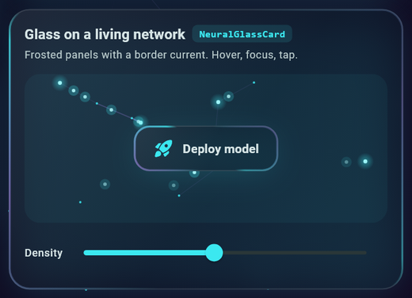 <br> **`NeuralGlassCard`** on **`NeuralNetworkBackground`**<br>frosted panels on a living network |

The original HUD, `AiThinkingAnimation`, in ring and Earth mode:

| Ring (dark) | Earth (light) |
| :---: | :---: |
| 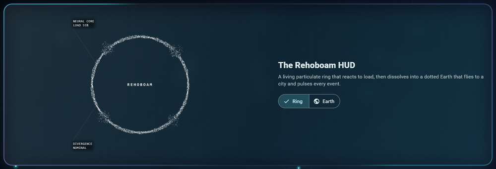 | 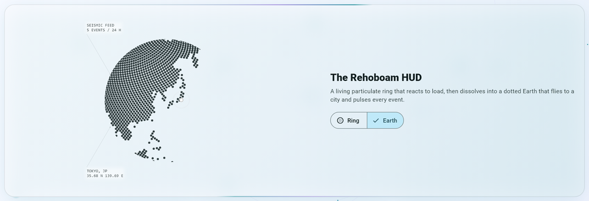 |

Everything in light mode, and on phones (including right-to-left):

| Desktop, light | Phone, dark | Phone, light, RTL |
| :---: | :---: | :---: |
| 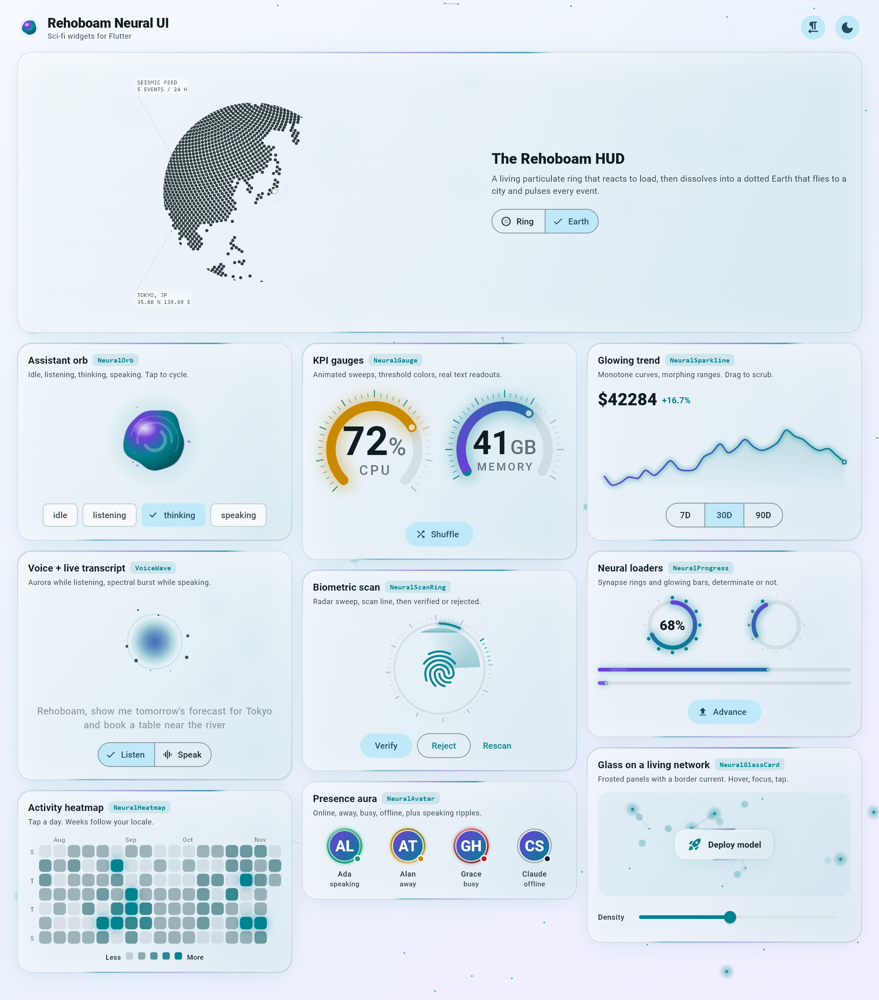 | 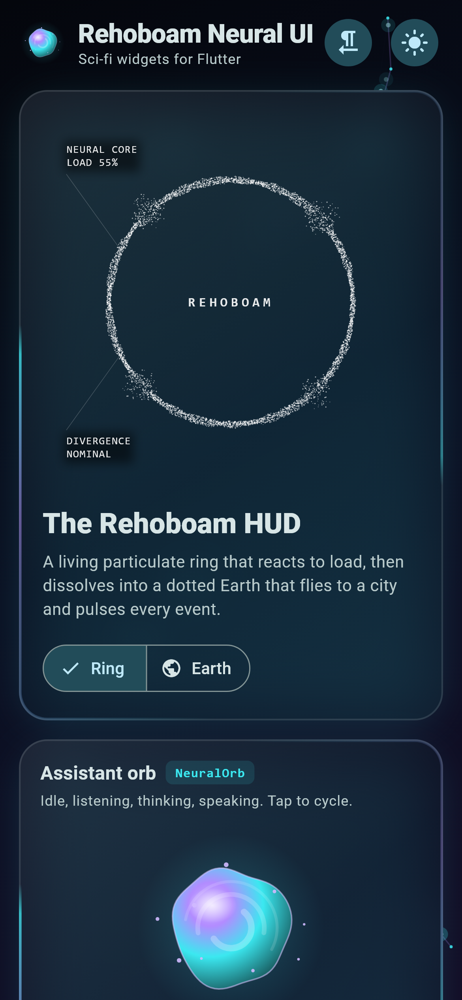 | 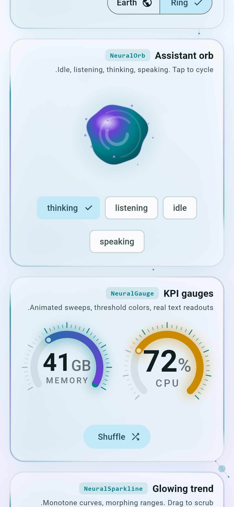 |

## Quick start

```yaml
dependencies:
  rehoboam_neural_ui: ^1.0.0
```

```dart
import 'package:rehoboam_neural_ui/rehoboam_neural_ui.dart';

// An assistant that reacts to the microphone.
NeuralOrb(
  state: NeuralOrbState.listening,
  level: micLevel, // 0..1, raw readings are fine (smoothed internally)
  onTap: toggleListening,
)

// A KPI that turns amber above 70 and red above 90.
NeuralGauge(
  value: cpu,
  unit: '%',
  label: 'CPU',
  thresholds: const [
    NeuralGaugeThreshold(70, Colors.amber),
    NeuralGaugeThreshold(90, Colors.red),
  ],
)

// A biometric check that navigates once the animation lands.
NeuralScanRing(
  status: verified ? NeuralScanStatus.success : NeuralScanStatus.scanning,
  progress: scanProgress,
  onResolved: (_) => Navigator.of(context).pop(),
  child: const Icon(Icons.fingerprint_rounded, size: 64),
)

// A living backdrop behind any screen.
NeuralNetworkBackground(child: yourDashboard)
```

The [example app](example/lib/main.dart) is a full adaptive dashboard (phone to
desktop, light and dark, LTR and RTL) using every widget.

## Theming

Every widget resolves its colors in this order:

1. the argument you pass (`color:`, `secondaryColor:`, `trackColor:`...);
2. a `NeuralThemeData` theme extension, for app-wide overrides;
3. the ambient `ColorScheme` (`primary` for the accent, `tertiary` for the
   secondary, `onSurface` for text and tracks, `error` for failures).

```dart
MaterialApp(
  theme: ThemeData(
    colorScheme: ColorScheme.fromSeed(seedColor: Colors.cyan),
    extensions: const [
      NeuralThemeData(
        accent: Color(0xFF00E5FF),
        success: Color(0xFF4ADE9B),
        glowIntensity: 1.3, // 0 disables every glow
      ),
    ],
  ),
)
```

## Widgets and parameters

### `AiThinkingAnimation`: the Rehoboam HUD

| Parameter | Default | Description |
| --- | --- | --- |
| `level` | `0` | Energy `0..1` driving the ring's ink texture. |
| `mode` | `listening` | `AiFaceMode.speaking` is faster and spikier. |
| `hudMode` | `ring` | `HudMode.earth` dissolves the ring into a dotted globe. |
| `targetLat` / `targetLon` | `null` | Where the globe flies (and zooms) in Earth mode. |
| `geoPoints` | `null` | Markers: `{'lat': .., 'lon': .., 'mag': ..}`. |
| `centerLabel` / `topLabel` / `bottomLabel` | `null` | HUD captions (mirrored in RTL). |
| `color` | `white` | Ring and label ink; pass `onSurface` on light themes. |
| `size`, `speed`, `animate`, `dotGlobeController`, `dotGlobeStyle`, `semanticsLabel` | | |

### `NeuralOrb`

| Parameter | Default | Description |
| --- | --- | --- |
| `state` | `idle` | `idle`, `listening`, `thinking`, `speaking`; changes ease over ~400 ms. |
| `level` | `0` | Audio level `0..1`, smoothed internally. |
| `onTap` | `null` | Makes it a button (push-to-talk). |
| `size`, `color`, `secondaryColor`, `speed`, `animate`, `semanticsLabel` | | |

### `VoiceWave` and `WordByWordTranscript`

| Parameter | Default | Description |
| --- | --- | --- |
| `VoiceWave.mode` | `listening` | Aurora blob, or spectral bars for `speaking`. |
| `VoiceWave.level` | `0` | Input level `0..1`. |
| `VoiceWave.color` / `secondaryColor` / `particleColor` | scheme | Overrides. |
| `WordByWordTranscript.text` | `''` | The partial or final transcript; only changed words re-animate. |
| `WordByWordTranscript.isFinal` | `false` | Stops emphasizing the last word. |
| `WordByWordTranscript.maxLines` | `3` | Keeps the newest lines visible. |
| `WordByWordTranscript.highlightIndex` | `null` | Emphasize a specific word (karaoke / TTS). |

`AudioLevelStream.instance` is a broadcast hub: feed it from any recorder
plugin with `addLevel(v)` and listen to `.stream`.

### `NeuralGauge`

| Parameter | Default | Description |
| --- | --- | --- |
| `value`, `min`, `max` | `—`, `0`, `100` | Reading (clamped; NaN shows `min`). |
| `unit`, `label`, `valueFormatter` | | Readout text (real `Text`, scales with font size). |
| `thresholds` | `[]` | `NeuralGaugeThreshold(value, color)` bands. |
| `sweepDegrees` | `270` | Arc length. |
| `ticks`, `strokeWidth`, `duration`, `curve`, `size`, colors | | |

### `NeuralSparkline`

| Parameter | Default | Description |
| --- | --- | --- |
| `data` | required | Oldest first; `NaN` / infinity become gaps. Changes morph smoothly. |
| `smooth` | `true` | Monotone cubic curve (never overshoots the data). |
| `fill`, `showLatestDot`, `strokeWidth`, `height`, `minY`, `maxY` | | |
| `interactive`, `onScrub`, `valueFormatter`, `labelBuilder` | | Drag / hover cursor with tooltip. |
| `mirrorInRtl` | `true` | Time flows with the reading direction. |

### `NeuralProgress`

| Parameter | Default | Description |
| --- | --- | --- |
| `value` | `null` | `0..1`, or `null` for indeterminate. Animates to new values. |
| `NeuralProgress(...)` | | Circular: `size`, `strokeWidth`, `nodes`, optional centered `child`. |
| `NeuralProgress.linear(...)` | | A glowing bar: `height`. |
| colors, `duration`, `semanticsLabel`, `animate` | | Announced as a percentage. |

### `NeuralHeatmap`

| Parameter | Default | Description |
| --- | --- | --- |
| `values` | required | `Map<DateTime, double>`, bucketed by calendar day (DST-safe; duplicates summed). |
| `endDate`, `weeks` | today, `20` | Range shown. Weeks start on the locale's first day. |
| `cellSize`, `cellSpacing` | fit, `3` | Cells fit the width unless fixed. |
| `onCellTap` | `null` | `(DateTime day, double value)`; the tapped cell is outlined. |
| `maxValue`, `showWeekdayLabels`, `showMonthLabels`, `monthLabelBuilder`, colors | | |

### `NeuralScanRing`

| Parameter | Default | Description |
| --- | --- | --- |
| `status` | `scanning` | `idle`, `scanning`, `success`, `failure`. |
| `progress` | `null` | `0..1`, or `null` for an indeterminate scan. |
| `onResolved` | `null` | Fires once the success / failure animation finishes. |
| `child` | `null` | Face, fingerprint or thumbnail, clipped to a circle. |
| `statusLabels`, `successColor`, `errorColor`, `color`, `size` | | Status changes are announced (live region). |

### `NeuralAvatar`

| Parameter | Default | Description |
| --- | --- | --- |
| `image`, `name` | `null`, `''` | Photo, falling back to grapheme-aware initials. |
| `presence` | `online` | `online`, `away`, `busy`, `offline`. |
| `speaking`, `level` | `false`, `0` | Voice ripples. |
| `showBadge`, `auraColor`, `onTap`, `presenceLabels`, `size` | | The badge sits at the bottom-end corner. |

### `NeuralGlassCard`

| Parameter | Default | Description |
| --- | --- | --- |
| `child` | required | Content. |
| `onTap` | `null` | Makes it a focusable button (Enter / Space, focus glow). |
| `blur` | `18` | Backdrop blur; `0` skips the backdrop filter. |
| `animateBorder`, `glow`, `borderRadius`, `borderWidth`, `padding`, `tint`, colors | | |

### `NeuralNetworkBackground`

| Parameter | Default | Description |
| --- | --- | --- |
| `child` | `null` | Content on top (keeps receiving input). |
| `density`, `maxNodes` | `1.0`, `140` | Nodes per 100×100 px, so phones and desktops look alike. |
| `linkDistance`, `pulses`, `interactive`, `seed`, `speed`, colors | | The pointer attracts nodes. Same seed, same network on every platform. |

## Accessibility and motion

- Every widget has a meaningful semantics label (and value where it makes
  sense: gauge reading, progress percentage, chart summary, heatmap totals).
  Decorative layers are excluded.
- With `MediaQuery.disableAnimations` (the OS *reduce motion* setting) every
  widget shows a still frame and state changes apply instantly; no frames are
  scheduled.
- Right-to-left: HUD labels, progress fills, gauges, chart time axes, heatmap
  weeks and avatar badges all mirror.

## Performance

- Continuous animations drive their `CustomPainter` through a `repaint`
  listenable: no widget rebuilds per frame, and every animated layer sits in
  its own `RepaintBoundary`.
- Particle and link buffers are preallocated `Float32List`s drawn in a few
  batched `drawRawPoints` calls; shaders and paths are cached per size.
- Randomness uses a 32-bit xorshift PRNG, so web and native draw identical
  scenes.

## Platforms

Android, iOS, web, macOS, Windows and Linux. The package is pure Dart and
Flutter (no `dart:io`, no plugins). The 3D globe comes from
[`dot_globe`](https://pub.dev/packages/dot_globe), which is also pure Dart.

## Screenshots

The images above are rendered from widget tests with real fonts:

```sh
cd example
flutter test test/screenshots_test.dart --dart-define=CAPTURE=true
python tool/make_media.py
```

## License

MIT
